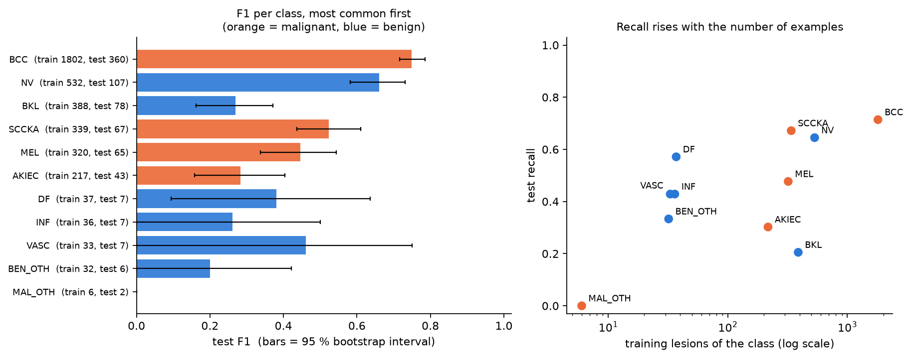
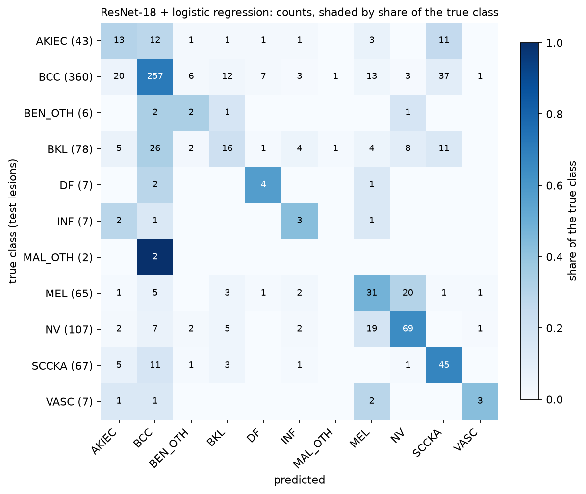

# The 11-class stretch target — which skin lesion is it?

**MILK10k skin-lesion classification** · Joshua Cole · seed 42 · Milestone 1 stretch goal

**Code in the repository** (https://github.com/jcole-jpg/Computer-Vision-and-Speech-Recognition):
[`notebooks/stretch_11_class.ipynb`](https://github.com/jcole-jpg/Computer-Vision-and-Speech-Recognition/blob/main/notebooks/stretch_11_class.ipynb) (the experiment, executed, every table and figure) ·
[`src/milk10k/multiclass.py`](https://github.com/jcole-jpg/Computer-Vision-and-Speech-Recognition/blob/main/src/milk10k/multiclass.py) (11-class metrics, power-weights, bootstrap) ·
[`src/milk10k/embeddings.py`](https://github.com/jcole-jpg/Computer-Vision-and-Speech-Recognition/blob/main/src/milk10k/embeddings.py) (frozen ResNet-18 embeddings, cached) ·
[`scripts/build_eleven_class_notebook.py`](https://github.com/jcole-jpg/Computer-Vision-and-Speech-Recognition/blob/main/scripts/build_eleven_class_notebook.py) (generates and runs the notebook) ·
[`tests/test_multiclass.py`](https://github.com/jcole-jpg/Computer-Vision-and-Speech-Recognition/blob/main/tests/test_multiclass.py) (tests).
Raw outputs: [`artifacts/eleven_class/final_table.csv`](https://github.com/jcole-jpg/Computer-Vision-and-Speech-Recognition/blob/main/artifacts/eleven_class/final_table.csv), [`artifacts/eleven_class/per_class_test.csv`](https://github.com/jcole-jpg/Computer-Vision-and-Speech-Recognition/blob/main/artifacts/eleven_class/per_class_test.csv), [`artifacts/eleven_class/scores.json`](https://github.com/jcole-jpg/Computer-Vision-and-Speech-Recognition/blob/main/artifacts/eleven_class/scores.json).

## Result

The primary target is `diagnosis_1` (3 classes). The stretch asks for the **specific diagnosis, 11 classes**, from basal cell carcinoma (48 % of
lesions) to other malignant (9 lesions in the whole dataset). On the 749 test lesions, scored once, the headline model, **frozen ResNet-18
embeddings + logistic regression**, reaches **macro-F1 0.423** (95 % bootstrap interval [0.353, 0.479]), against
0.281 for the best hand-crafted-feature forest and 0.065 for always predicting BCC. Macro-F1 is averaged over the ten
evaluable classes: MAL_OTH (6 train, 2 test lesions) is reported but never averaged in, and is never found (the all-11 value is 0.385).

| model | macro-F1 (10 classes) | 95 % CI | balanced accuracy | accuracy | top-3 accuracy |
|---|---|---|---|---|---|
| majority class (BCC) | 0.065 | [0.062, 0.068] | 0.091 | 0.481 |  |
| stratified random | 0.105 | [0.089, 0.123] | 0.096 | 0.284 |  |
| hand-crafted forest | 0.281 | [0.232, 0.328] | 0.265 | 0.546 | 0.845 |
| ResNet-18 + logistic regression  **[HEADLINE]** | 0.423 | [0.353, 0.479] | 0.434 | 0.591 | 0.866 |
| MLP, 66 hand-crafted | 0.295 | [0.245, 0.340] | 0.320 | 0.498 | 0.813 |
| MLP, ResNet-18 embeddings | 0.458 | [0.390, 0.516] | 0.506 | 0.599 | 0.876 |

The headline was fixed **before** the test split was opened: the finalist with the higher cross-validated macro-F1 on train
(0.408 for the embeddings against 0.305 for the forest). The MLP on the embeddings scores
0.458 on test, but its interval overlaps the headline's and the rule had already chosen; it is reported, not promoted.

## Method

* Same committed lesion-level splits as Sessions 5–7 (3,742 train / 749 val / 749 test lesions), same cost habits from Session 3.
* Session 5's comparison re-run for 11 classes: 7 feature sets × 6 models, 5-fold CV macro-F1 on **train only** (best cell: random forest on
  derm + clinical, CV 0.294 ± 0.020; majority class 0.065).
* The one new decision, **how hard to up-weight rare classes**, tested rather than assumed: weight = (N / (K·n_c))^p with p ∈ {0, 0.25, 0.5, 0.75, 1},
  chosen by CV mean (p = 0.75); the fold spread is as large as the gaps between neighbouring p.
* One extension beyond the course: 512-number ResNet-18 embeddings of each image (frozen, ImageNet weights, nothing trained on skin) with a logistic-regression head,
  and an MLP in the Session 6 recipe on top of them. The question: is the low hand-crafted score a ceiling of the features or of the data?

## What the numbers say

* **Frozen CNN features beat hand-crafted ones by a wide margin** (0.423 against 0.281, intervals do not overlap; CV on train ordered them the same way).
  The low hand-crafted score is a ceiling of the features, not only of the data.
* **Useful on common classes, an anecdote on rare ones.** BCC, NV and SCCKA carry the average; DF, INF, VASC and BEN_OTH have 6–7 test lesions each and
  intervals as wide as 0.4–0.6.

| class | train lesions | test lesions | recall | F1 | F1 95 % CI |
|---|---|---|---|---|---|
| BCC | 1802 | 360 | 0.71 | 0.75 | [0.72, 0.79] |
| NV | 532 | 107 | 0.64 | 0.66 | [0.58, 0.73] |
| BKL | 388 | 78 | 0.21 | 0.27 | [0.16, 0.37] |
| SCCKA | 339 | 67 | 0.67 | 0.52 | [0.44, 0.61] |
| MEL | 320 | 65 | 0.48 | 0.45 | [0.34, 0.54] |
| AKIEC | 217 | 43 | 0.30 | 0.28 | [0.16, 0.40] |
| DF | 37 | 7 | 0.57 | 0.38 | [0.09, 0.64] |
| INF | 36 | 7 | 0.43 | 0.26 | [0.00, 0.50] |
| VASC | 33 | 7 | 0.43 | 0.46 | [0.00, 0.75] |
| BEN_OTH | 32 | 6 | 0.33 | 0.20 | [0.00, 0.42] |
| MAL_OTH | 6 | 2 | 0.00 | 0.00 | [0.00, 0.00] |

* **The errors are clinically readable.** Largest confusions:

| true → predicted | lesions | share of the true class |
|---|---|---|
| BCC → SCCKA | 37 | 10% |
| BKL → BCC | 26 | 33% |
| BCC → AKIEC | 20 | 6% |
| MEL → NV | 20 | 31% |
| NV → MEL | 19 | 18% |

  31 % of melanomas are called naevi, the error that matters most; a screening threshold has to push it down.
* **Eleven classes do not cost the triage answer.** Collapsing to benign / malignant (P(malignant) = sum of the five malignant columns), the 11-class ResNet model has
  AUC 0.816 against 0.783 for the Session 5 three-class forest. With a screening threshold chosen on validation for 95 % sensitivity it catches
  95.3% of malignant test lesions at specificity 0.425 and 1.83 cost per lesion (Session 5: 0.944, 0.344, 2.19).

## What this does not show

* **Not a clinical tool.** 749 test lesions from one dataset, one split, no external validation; the 71.7 % malignant share of the test split is far above primary care.
* **Differences of a few hundredths are noise.** With 7 lesions in four classes a single lesion moves a class F1 by more than 0.1.
* **Next step.** Fine-tune a CNN end to end (done for the 3-class target in Session 7: [`reports/session7_report.md`](https://github.com/jcole-jpg/Computer-Vision-and-Speech-Recognition/blob/main/reports/session7_report.md)) and pool train + validation for cross-validation, so the rare classes get more than six to eight lesions.
