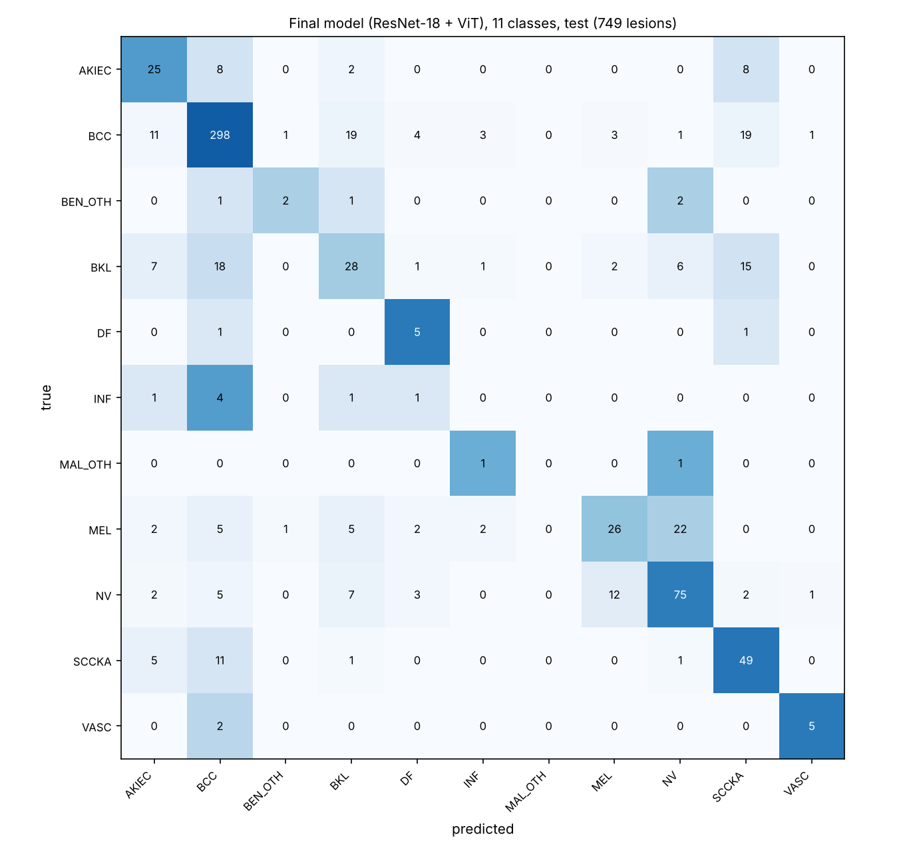
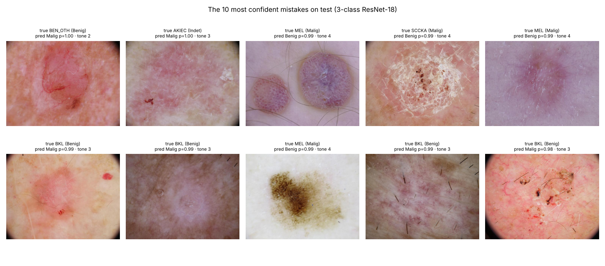
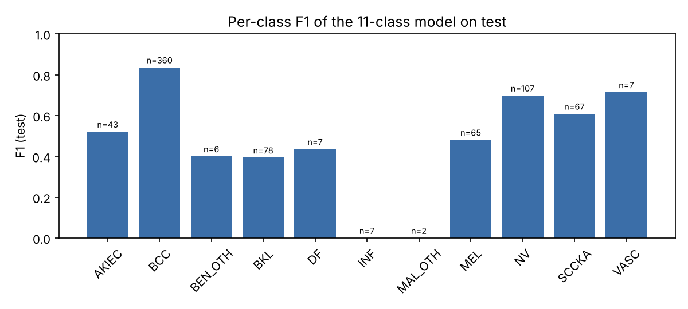

# MILK10k skin-lesion classification — final report (Milestones 4 and 5)

**Computer Vision & Speech Recognition** · Joshua Cole · approach name `EADA-CV26-JC`
**Repository:** <https://github.com/jcole-jpg/Computer-Vision-and-Speech-Recognition>

## 1. Result in one paragraph

The final system diagnoses a skin lesion into the 11 MILK10k classes from its **dermoscopic image**. It averages the probabilities of two networks that make different mistakes — a **ResNet-18 fine-tuned in full** and a **frozen ViT-B/16 with a logistic-regression head** — and turns them into decisions with **one threshold per class tuned on validation**. On the 749 internal test lesions, scored once after every choice was fixed, it reaches **macro-F1 0.510** (95 % bootstrap interval 0.43–0.56; validation 0.503), against 0.059 for always answering "BCC" and 0.416 for the fine-tuned ResNet-18 alone. As a malignant-vs-benign screen (sum of the four malignant class probabilities) its test AUC is 0.83. **Official leaderboard score: ____ (screenshot in §7) — my local estimate is 0.51.**

## 2. Data, task and split (Milestones 1–3, unchanged)

* MILK10k: 5,240 lesions × 2 images (dermoscopic + clinical close-up), 11 classes, biopsy-enriched (≈ 69 % malignant, BCC 48 %, MAL_OTH 9 lesions). Every image is 600 × 450.
* Split once, **by lesion**, with `StratifiedGroupKFold` (groups = `lesion_id`, stratified on the 11-class label, seed 42): **3,742 train / 749 validation / 749 test lesions**; zero `lesion_id` overlap is asserted in code. Every model in this report uses these same three files.
* Input: the dermoscopic image only (the leaderboard brief's default; one row per lesion, no per-image leakage), stretched to 224 × 224 with PIL bilinear, ImageNet mean/std. Training augmentation: flips, quarter turns, ±10 % brightness/contrast (the label-safe limits measured in Session 3). Metadata (age, sex, site, tone) is **not** used as input: it carries shortcut risk and is not available in the same form at the point of use.
* Metric: **macro-F1** (every class counts equally; the leaderboard's metric). Validation chooses; test is opened once.

## 3. Scoreboard (same split, same metric)

**3 classes (diagnosis_1)** — the analysis target of Milestones 2–4:

| Milestone | Model | val macro-F1 | test macro-F1 |
|---|---|---|---|
| — | always "Malignant" | 0.273 | 0.273 |
| M2 | random forest, 66 hand-crafted colour/texture features | 0.568 | 0.536 |
| M3 | MLP on raw 32×32 pixels | 0.549 | 0.484 |
| M3 | CNN from scratch (slide-15 network) | 0.564 | 0.483 |
| M4 | ResNet-18 frozen + logistic regression | 0.612 | 0.505 |
| M4 | ViT-B/16 frozen + logistic regression | 0.616 | 0.618 |
| M4 | **ResNet-18 fine-tuned in full — kept (best validation)** | **0.703** | **0.598** |

**11 classes** — the leaderboard target (Milestone 5):

| Model | val macro-F1 | test macro-F1 |
|---|---|---|
| always "BCC" | — | 0.059 |
| M2-style forest, 66 hand-crafted features (stretch notebook) | CV 0.30 | 0.256 |
| ResNet-18 frozen + logistic regression | 0.301 | 0.312 |
| ViT-B/16 frozen + logistic regression | 0.375 | 0.401 |
| ResNet-18 fine-tuned, 11 outputs, argmax | 0.422 | 0.416 |
| ResNet-18 fine-tuned + ViT head, average, argmax | 0.463 | 0.463 |
| **same + per-class thresholds (submitted)** | **0.503**\* | **0.510** |

\* thresholds were tuned on validation, so 0.503 is optimistic; the test number is the honest one.

## 4. Milestone 4 — the best model, justified

**CNN vs ViT, fairly.** Both backbones frozen, same dermoscopic images and preprocessing, same head (standardised features + multinomial logistic regression, balanced class weights), regularisation `C` picked on validation from the same grid, same metric (`src/milk10k/compare.py`). Frozen, the ViT is the better feature extractor: 11 classes 0.375 vs 0.301 on validation; on 3 classes they tie on validation (0.616 vs 0.612). Its 86.6 M weights cannot be fine-tuned on a laptop CPU, while ResNet-18 (11.7 M) can, and **fine-tuning ResNet-18 beat both frozen models on validation** (3 classes 0.703; 11 classes 0.422). The 3-class model kept for Milestone 4 is therefore the fine-tuned ResNet-18 (`data/processed/session07/resnet18_s3_full.pt`, test predictions in `artifacts/final/m4_test_predictions_3class.csv`). Note the honest twist: on 3 classes the frozen ViT scores higher on *test* (0.618 vs 0.598) — I did not switch, because the test split is not a selection tool.

**Error analysis** (3-class pick, test). Recall: Benign 0.70, Indeterminate 0.41, Malignant 0.79. The ten most confident mistakes (`reports/figures/final_misclassified.png`) share three things: (1) **pink, vascular, non-pigmented lesions** — benign BKL/BEN_OTH called malignant with p ≈ 0.99, because red vessels and scale are also what BCC/SCC look like; (2) **featureless or regressive melanomas** called benign (a purple macule with no network, a pale structureless lesion); (3) **thick hair and scale** covering the lesion. All are visually ambiguous even for dermoscopy, and all are the cases where a clinician would rely on history and evolution, which the image does not contain. In the 11-class final model the costly confusion is **MEL → NV (22 of 65 test melanomas)**; INF and AKIEC are absorbed by BCC/SCCKA (`reports/figures/final_cm_11class_test.png`).

**Fairness check** (`artifacts/final/fairness_test_11class.csv`, `m4_fairness_3class.csv`). Test lesions per skin tone: tone 1 = 18, 2 = 78, 3 = 448, 4 = 151, 5 = 54, tone 0 = none. Leaving out tone 1, 3-class accuracy ranges from 0.73 (tone 2) to 0.85 (tone 5) and 11-class accuracy from 0.60 (tone 2) to 0.70 (tone 5). Tone 2 is the weakest group in both models, but with 78 lesions the difference is within sampling noise; tones 0–1 are too few to conclude anything, which is itself the finding: **the model is unvalidated on dark skin**. By sex: female 0.73 / male 0.77 accuracy (3 classes), 0.69 / 0.68 (11 classes) — no meaningful gap.

## 5. Milestone 5 — the final pipeline

1. **11-class CNN** (`src/milk10k/final.py::train`): ImageNet ResNet-18, `fc = nn.Linear(512, 11)`, all layers trained; Adam with head 1e-3 / backbone 1e-4; cross-entropy with class weights `(N / (K·n_c))^0.75` from train (power chosen by CV in the stretch notebook); batch 32, 10 epochs; the epoch with the best validation macro-F1 is kept (epoch 10, val 0.422). Training loss fell from 1.77 to 0.45 while validation loss rose after epoch 3 — the usual overfitting signature, controlled by keeping the best-validation epoch and by the ensemble.
2. **ViT head** (`train_vit_head`): logistic regression (C = 0.1, chosen on validation) on the frozen 768-number class token of the train lesions.
3. **Average** (`FinalModel.proba`): `0.5 · p_ViT + 0.5 · p_CNN`. The weight was the best of {0, 0.25, 0.5, 0.75, 1} on validation (0.463 vs 0.422 and 0.375 for the parts).
4. **Decision rule** (`tune_thresholds`): the leaderboard binarises each column at 0.5, so raw softmax values leave lesions with no class and rare classes rarely reach 0.5. One threshold per class is tuned on validation (grid 0.05–0.95, ties → closest to 0.5): MEL 0.25, BCC 0.30, AKIEC/BEN_OTH 0.35, BKL/INF 0.40, NV/SCCKA/VASC 0.45, MAL_OTH 0.50, DF 0.55. Test: argmax 0.463 → raw ≥ 0.5 0.481 → **thresholds 0.510**. The gain comes from DF (0.43 → 0.71), INF (0 → 0.14) and VASC; the risk is that thresholds for classes with 6–8 validation lesions are noisy, which is why the test check matters. The lower MEL threshold also catches more melanomas — the right direction clinically.
5. **`predict(image_path)`** loads both networks once, prepares the image with `eval_tensor` — **the same function validation used** (RGB, PIL 224 × 224, no augmentation, ImageNet normalisation) — runs in `eval()` mode without gradients, and returns the 11 probabilities, the top class and P(malignant). Re-running validation and test through this deployment path reproduces the numbers exactly (val 0.4628, test 0.4625 for argmax), which is the evidence that there is no train/serve skew.
6. **`scripts/make_submission.py`** → `artifacts/final/submission.csv`: 479 rows (one per test lesion, dermoscopic image), columns `lesion, AKIEC, …, VASC` in `training_gt.csv` order, values 1.0/0.0. `check_submission` asserts the header, the row count, unique lesions and the [0, 1] range before writing. The raw averaged probabilities are in `submission_probabilities.csv`; the argmax version in `submission_argmax.csv`.

## 6. Limits — what a clinician should know

MAL_OTH (9 lesions in the whole dataset, 2 in test) is never predicted, so its F1 is 0 and caps macro-F1 at 10/11 of what the other classes achieve. MILK10k is biopsy-enriched: its 69 % malignancy is not a clinic's or a phone user's prevalence, so precision would collapse in screening and every number here describes lesions that a dermatologist already found suspicious. Only the dermoscopic view is used. Tones 0–1 are almost absent. The model is a decision-support prototype for suspicious lesions, not a diagnostic device.

## 7. Official leaderboard

Submitted file: `artifacts/final/submission.csv` · approach name `EADA-CV26-JC` · ImageNet pretraining declared.

| | macro-F1 |
|---|---|
| Local estimate (internal test, 749 lesions, thresholds tuned on validation) | 0.510 (0.43–0.56) |
| **Official MILK10k leaderboard (479 lesions)** | **____** |

*[Screenshot of the official result here.]*

Why the two can differ: the benchmark lesions are a separate collection (other time window, possibly other centres and class mix); with only a handful of DF, VASC, INF, BEN_OTH and MAL_OTH lesions in 479, one hit or miss moves a class's F1 by 0.1–0.3 and macro-F1 by ~0.02; the thresholds were tuned on 749 validation lesions and can be slightly off for the benchmark's mix. A gap of a few points in either direction is expected; a much lower official score would point to a distribution shift.

## 8. Reproduce

```bash
pip install -r requirements.txt
export MILK10K_DATA=/path/to/milk10k
python scripts/extract_frozen_features.py
python scripts/compare_cnn_vit.py
python scripts/train_final.py --test-images data/raw/MILK10k_Test_Input \
       --test-metadata data/raw/MILK10k_Test_Metadata.csv
python scripts/analyse_final.py
python scripts/threshold_check.py
python scripts/predict.py path/to/ISIC_xxxxxxx.jpg
pytest tests/
```

Order: extract frozen features → compare CNN vs ViT → train the CNN, the ViT head, evaluate, tune thresholds, write the submission → analysis → threshold check → predict one image → tests. Seeds: splits 42, training 0. Training the CNN takes ~5 min/epoch on a 2-core CPU, ~30 s on Apple MPS.

## Appendix — figures






