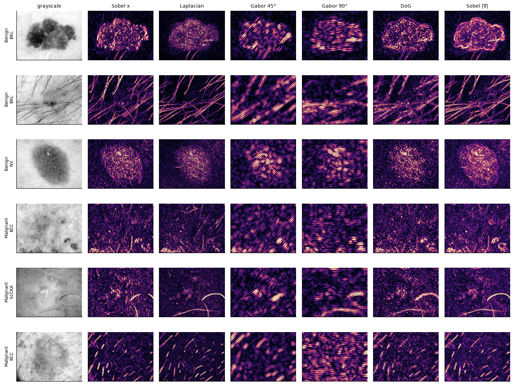
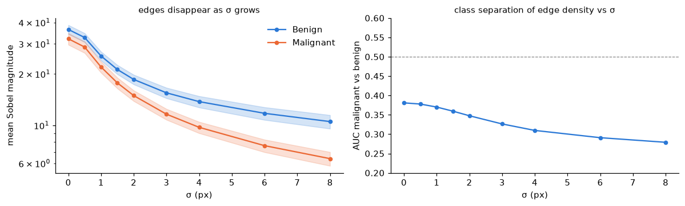
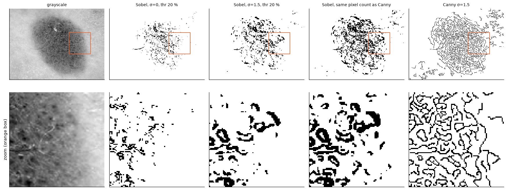
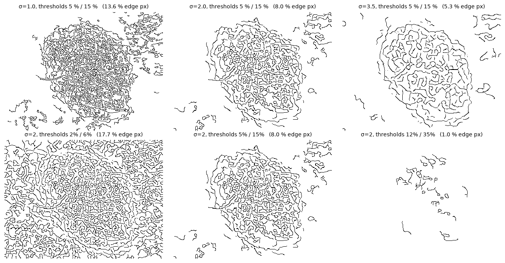

# Session 4 homework — Filters on skin lesions

**MILK10k skin-lesion classification** · Joshua Cole · seed 42

**Notebook with all code, figures and outputs:** [`notebooks/04_filters.ipynb`](https://github.com/jcole-jpg/Computer-Vision-and-Speech-Recognition/blob/main/notebooks/04_filters.ipynb)
(repository: <https://github.com/jcole-jpg/Computer-Vision-and-Speech-Recognition>). Code used: [`src/milk10k/filters.py`](https://github.com/jcole-jpg/Computer-Vision-and-Speech-Recognition/blob/main/src/milk10k/filters.py) (filter kernels, `gaussian_kernel`,
`sobel_edges`, and `canny` written from scratch: Gaussian blur → Sobel gradients → non-maximum suppression → double threshold → hysteresis),
built by [`scripts/build_session4_notebook.py`](https://github.com/jcole-jpg/Computer-Vision-and-Speech-Recognition/blob/main/scripts/build_session4_notebook.py). Numbers below are re-read from the executed notebook
(`artifacts/session04/*.csv`).

**What was done.** A bank of hand-built filters (Sobel, Prewitt, Laplacian, sharpen, Gabor at three angles, difference of Gaussians) and the 64 first-layer
filters of a pretrained ResNet-18 were applied to dermoscopic images from the training split. Edge statistics were compared between
Benign and Malignant lesions (central 60 % of each image, so the vignette is not counted) on a 300-image sample and on all 3,653 benign and
malignant training lesions, summarised as an AUC (0.5 = no difference) with a bootstrap interval. `sigma` was swept from 0 to 8 and Canny
was implemented as a function and compared with Sobel on one image.

## Q1. Edges and textures: malignant vs benign

*Rows 1 – 3 benign (BKL, BKL, NV), rows 4 – 6 malignant (BCC, SCCKA, BCC); picked at random with a fixed seed. Hairs dominate rows 2, 5 and 6.*

**Q1. Do edges and textures differ between malignant and benign lesions?**
Yes on average, but weakly, and mostly through global contrast rather than through "irregular borders".

* On all 3,653 training lesions, malignant lesions have *lower* raw edge density (Sobel AUC 0.40, 95 % CI [0.38, 0.42]) and
  lower Laplacian variance (0.41). That follows from lower image contrast: grayscale standard deviation has a median of 15 for
  malignant vs 26 for benign lesions (AUC 0.30), and malignant images are brighter (AUC 0.69). Many malignant lesions in MILK10k
  (basal and squamous cell carcinoma) are pale and low-contrast, whereas benign nevi and keratoses are dark and pigmented.
* Divide out the contrast and the sign flips: edge density per unit of contrast is *higher* in malignant lesions (AUC 0.70 [0.68, 0.72]),
  i.e. their local structure is busier relative to how much they stand out. Gabor, DoG and Canny measures on the 300-lesion
  sample are weaker still (AUC 0.43 – 0.58).
* Colour is not worse: mean saturation alone reaches AUC 0.62. None of the single filter measures separates the classes
  better than about 0.70, so on their own they are weak classifiers (Session 5 confirms this: the three texture features add little).
* The ResNet-18 filters make the same point. The two most class-separating of the 64 are colour blobs (AUC 0.71 and 0.67);
  the grayscale edge-detector tiles sit at 0.33 – 0.47, again reflecting contrast.
* Confounds to keep in mind: hairs (strong straight edges in every filter, e.g. rows 2, 5 and 6 of the filter figure), the dermatoscope
  rim, and the fact that 69 % of lesions are malignant, so a single 0.60 feature adds little.

## Q2. `sigma` in `scipy.ndimage.gaussian_filter`

**Q2. What does `sigma` do in `scipy.ndimage.gaussian_filter`?**
It is the standard deviation, in pixels, of the Gaussian weights used to average each pixel with its neighbours. The kernel radius is
`int(4σ + 0.5)` (σ = 2 → 8 px, a 17-px window; σ = 8 → 32 px), the half-height width is 2.355 σ, and a hand-built kernel
(`flt.gaussian_kernel`) reproduces scipy exactly (max difference 0.0). Larger σ removes finer detail: mean Sobel magnitude falls from
36.4 (benign) and 32.1 (malignant) at σ = 0 to 10.5 and 6.4 at σ = 8, and the benign/malignant AUC of edge density drifts from
0.38 to 0.28. The class gap therefore **grows** as fine texture is blurred away, which says the difference lives in coarse structure
and contrast, not in fine texture. σ is in pixels, so the same value blurs a 200-px image relative to its content ten times more than a 2,000-px one.

## Q3. Canny implemented as a function, compared with Sobel

*Top: whole image (400 × 300 px). Bottom: the orange box, enlarged. All edge maps are binary.*

**Q3. Canny vs Sobel on one image** (benign nevus, 400×300 px, Canny σ = 1.5, thresholds 5 % / 15 % of the peak gradient):

| | edge pixels | pixels not on a 1-px line | connected pieces |
|---|---|---|---|
| Sobel, σ = 0, threshold 20 % | 2.9 % | 4.9 % | 564 |
| Sobel, σ = 1.5, threshold 20 % | 5.2 % | 28.3 % | 321 |
| Sobel with the same pixel count as Canny | 10.2 % | 35.7 % | 368 |
| **Canny σ = 1.5** | 10.2 % | **0.03 %** | 309 |

Sobel marks every pixel whose gradient exceeds one global threshold, so edges come out as thick blobs once the image is blurred
(28 – 36 % of its pixels are not on a one-pixel line) or as broken specks when it is not (564 fragments). Canny's non-maximum
suppression reduces every ridge to one pixel, and hysteresis keeps weak pixels that continue a strong edge and drops isolated ones,
so it gives thin, continuous contours at the same pixel budget. The costs: three parameters (σ, low, high), more computation, and
it still traces everything that looks like an edge: at σ = 1.5 the lesion interior is a tangle of pigment-network contours and hairs
survive. A larger σ (3.5 in the last figure) is what leaves the lesion outline and discards the texture.

*Top row: σ = 1, 2, 3.5 at fixed thresholds. Bottom row: σ = 2 with low/high thresholds 2 %/6 %, 5 %/15 %, 12 %/35 % of the peak gradient.*
