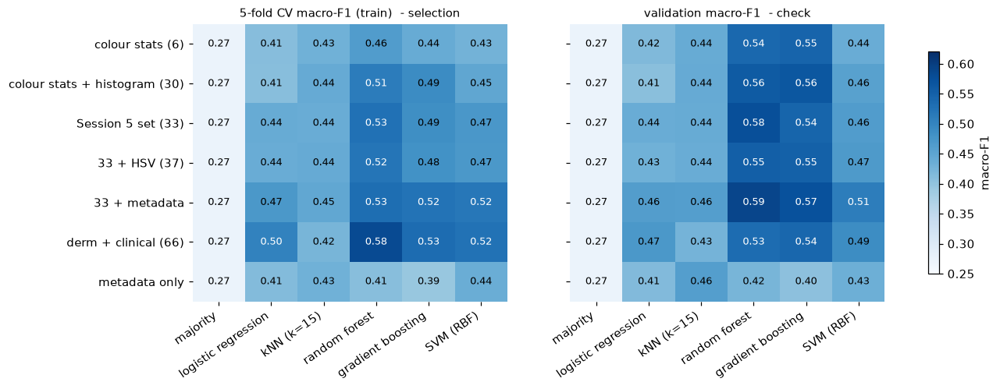
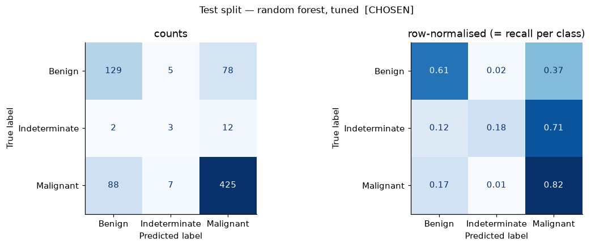

# Session 5 — A classical machine-learning baseline

**MILK10k skin-lesion classification** · Joshua Cole · seed 42

**Code in the repository** (https://github.com/jcole-jpg/Computer-Vision-Speech-Recognition):
[`notebooks/05_classical_baseline.ipynb`](https://github.com/jcole-jpg/Computer-Vision-Speech-Recognition/blob/main/notebooks/05_classical_baseline.ipynb) (the experiment, executed, with every table and figure) ·
[`src/milk10k/features.py`](https://github.com/jcole-jpg/Computer-Vision-Speech-Recognition/blob/main/src/milk10k/features.py) (colour / histogram / texture / HSV / metadata features, cached extraction, lesion-level splits) ·
[`scripts/build_session5_notebook.py`](https://github.com/jcole-jpg/Computer-Vision-Speech-Recognition/blob/main/scripts/build_session5_notebook.py) (generates and runs the notebook) ·
[`tests/test_features.py`](https://github.com/jcole-jpg/Computer-Vision-Speech-Recognition/blob/main/tests/test_features.py) (tests).
Raw outputs: [`artifacts/session05/baseline_scores.json`](https://github.com/jcole-jpg/Computer-Vision-Speech-Recognition/blob/main/artifacts/session05/baseline_scores.json), [`artifacts/session05/feature_model_grid.csv`](https://github.com/jcole-jpg/Computer-Vision-Speech-Recognition/blob/main/artifacts/session05/feature_model_grid.csv).

## Result

The baseline to beat is a **random forest**, **test macro-F1 0.536** (95 % bootstrap interval [0.472, 0.601])
on derm + clinical (66) features; the same forest on the 33 dermoscopic features alone scores 0.528.
Always predicting the majority class scores 0.273. The test split was scored once, after every choice was fixed.

| model | features | val macro-F1 | test macro-F1 | 95% CI | test accuracy | Malignant recall | cost / lesion |
|---|---|---|---|---|---|---|---|
| majority class | Session 5 set (33) | 0.273 | 0.273 | [0.266, 0.280] | 0.694 | 1.00 | 0.40 |
| random forest, course recipe | Session 5 set (33) | 0.575 | 0.528 | [0.452, 0.597] | 0.728 | 0.82 | 6.13 |
| random forest, tuned  [CHOSEN] | derm + clinical (66) | 0.568 | 0.536 | [0.472, 0.601] | 0.744 | 0.82 | 6.13 |

## Method

Seven feature sets × six models (42 configurations) are compared by 5-fold cross-validation
*on the training split only*; the best configuration is tuned with a small grid search, refit on the
training split, checked on the validation split, and finally scored **once** on the test split with a
bootstrap confidence interval. Features are scaled with a `StandardScaler` that lives *inside* the
pipeline, so every fold (and the validation/test splits) is scaled with training-fold statistics only.

| Decision | Choice | Why |
|---|---|---|
| Unit of analysis | one row per **lesion** | a lesion has two photos; splitting by image would leak the lesion across train/test (Session 3) |
| Splits | `artifacts/splits/{train,val,test}.csv`, seed 42, 70 / 15 / 15 | already verified lesion-disjoint and stratified |
| Metric | **macro-F1** | accuracy rewards predicting "Malignant" for everything (69 % of lesions); macro-F1 weighs the rare *Indeterminate* class as much as the others |
| Selection | mean CV macro-F1 on **train** | the validation split holds only 17 Indeterminate lesions, too few to choose a model on |
| Imbalance | `class_weight="balanced"` where the model supports it | cheapest correction; no resampling that could touch validation data |

## Feature sets × models

6 models × 7 feature sets, 5-fold cross-validated macro-F1 on the training lesions (selection) and one fit scored on validation (check):

* **Tree ensembles lead.** Random forest is the best or tied-best model on every image feature set, gradient boosting is close behind,
  and kNN, logistic regression and the RBF-SVM trail. The signal is non-linear and unevenly scaled (histogram bins that are almost always
  0, heavy-tailed texture values), which trees handle without help.
* **Features add up slowly.** With the forest, going from 6 colour statistics (CV 0.46) to adding the colour histogram (0.51) and the three texture
  features (0.53) buys about +0.07 in total. HSV statistics add nothing (0.52).
* **The clinical photograph helps in CV, but not reliably.** Adding the clinical image's 33 features lifts the cross-validated forest to
  0.58 and also helps logistic regression, boosting and the SVM by 0.04 – 0.06. But the fold-to-fold spread is ±0.04, and on the validation
  split the same forest *drops* (0.53 vs 0.58 with dermoscopy alone). Treat it as a small, unconfirmed gain.
* **Age, sex and body site carry some signal, but not much on top of the image.** Metadata alone beats the majority model
  (CV 0.44 vs 0.27), yet adding it to the forest changes nothing (0.531 vs 0.526); it helps the linear model and the SVM a little.
  It is a legitimate input (a clinician knows it), but it also partly encodes how lesions came to be in the study (referral, biopsy), so it is
  kept as an option rather than a requirement.
* **No configuration is clearly best.** The top four rows of the table are within one standard deviation of each other; the choice
  below follows the rule set in advance (highest CV mean), not a claim that it is truly better.

## Tuning, final evaluation and reading

The winning family (random forest on `derm + clinical (66)`) was tuned with a small grid (`max_features`, `min_samples_leaf`) by the same 5-fold CV.
Best settings: `{'model__max_features': 'sqrt', 'model__min_samples_leaf': 5}`; CV 0.582, validation 0.568.

* **Headline.** The chosen forest scores **test macro-F1 0.536** (95 % bootstrap CI 0.47 – 0.60) against 0.273 for always predicting
  Malignant. Accuracy is 74.4 % against 69.4 % for that trivial rule, so the extra information is real but modest.
  Validation (0.568) and CV (0.582) agree within the interval; the spread between them is the noise of a 749-lesion split.
* **Tuning changed nothing.** Searching `min_samples_leaf` and `max_features` (6 settings, 5-fold CV) moved the CV score by less than 0.001;
  the forest was already near its plateau, so the remaining error is in the features, not the hyper-parameters.
* **The extra feature set does not matter at the headline level.** The course-recipe forest on the 33 dermoscopic features alone gets test
  macro-F1 0.528 (CI 0.45 – 0.60), statistically indistinguishable from the chosen configuration. That 33-feature forest is the like-for-like
  number for the Session 6 MLP, which sees the same 33 inputs; the 66-feature forest is the best baseline to beat overall.
* **Per class.** Malignant F1 0.82, Benign 0.60, Indeterminate 0.19: the forest finds 3 of 17 Indeterminate lesions. Macro-F1 averages these,
  so one Indeterminate lesion more or less moves it by roughly ±0.01.
* **The error that matters.** 88 of 520 malignant lesions (17 %) are predicted Benign. Under the cost matrix from Part A (a missed
  malignancy costs 50, a needless work-up 1) the forest costs 6.13 per lesion, **worse** than the trivial "always Malignant" rule at 0.40.
  Macro-F1 improved over the trivial baseline, but this model is not safe as a screening tool, and a deployed version would need a
  decision threshold that favours Malignant recall.
* **What drives it.** Permutation importance is flat and noisy (error bars cross zero): texture of the clinical photograph (edge density,
  roughness) and blue-channel contrast lead, consistent with the Session 4 finding that contrast and texture carry most of the filter signal.
  No single feature dominates.
* **Limits.** (1) Only 17 Indeterminate lesions per evaluation split, so that class's score is mostly noise. (2) 42 configurations were compared
  on a CV score with ±0.04 spread; the winner's margin is smaller than the selection noise. (3) MILK10k has no patient id, so one patient's
  lesions can sit in different CV folds, which makes CV slightly optimistic. (4) Test was scored once, after every choice was fixed.
