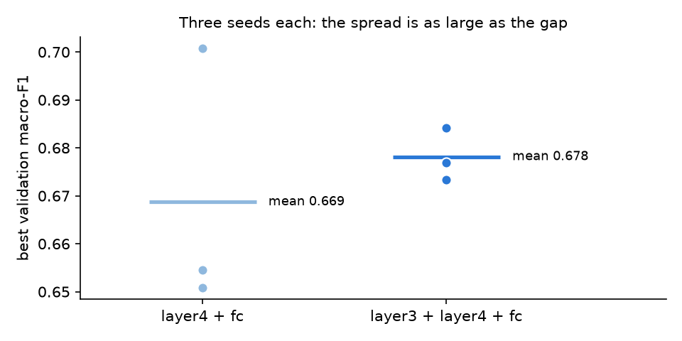

# Session 7 — Mini-challenge (slide 29): unfreeze `layer3` as well?

**Computer Vision & Speech Recognition** · Joshua Cole · MILK10k skin-lesion classification (3 classes) · seed 0, 1, 2

**Repository:** <https://github.com/jcole-jpg/Computer-Vision-and-Speech-Recognition>

**Code that completes the exercise:**
[`notebooks/07_cnn.ipynb`](https://github.com/jcole-jpg/Computer-Vision-and-Speech-Recognition/blob/main/notebooks/07_cnn.ipynb) (section 5, executed, with outputs) ·
[`src/milk10k/cnn.py`](https://github.com/jcole-jpg/Computer-Vision-and-Speech-Recognition/blob/main/src/milk10k/cnn.py) (`resnet18(trainable=...)`, `fit_cnn`, `count_parameters`) ·
[`scripts/build_session7_notebook.py`](https://github.com/jcole-jpg/Computer-Vision-and-Speech-Recognition/blob/main/scripts/build_session7_notebook.py) (generates and runs the notebook) ·
[`tests/test_cnn.py`](https://github.com/jcole-jpg/Computer-Vision-and-Speech-Recognition/blob/main/tests/test_cnn.py) (tests) ·
results: [`artifacts/session07/mini_challenge.csv`](https://github.com/jcole-jpg/Computer-Vision-and-Speech-Recognition/blob/main/artifacts/session07/mini_challenge.csv), [`artifacts/session07/runs/`](https://github.com/jcole-jpg/Computer-Vision-and-Speech-Recognition/blob/main/artifacts/session07/runs) (per-epoch history of every run).

## The exercise

Pretrained ImageNet ResNet-18 with a new `fc = Linear(512, 3)`. Compare **`layer4 + fc`** trainable (the usual default) against **`layer3 + layer4 + fc`**
trainable. Same data (3,742 / 749 / 749 lesion-level splits), same augmentation, same 10 epochs, class-weighted cross-entropy, Adam with the new head at 1e-3 and the unfrozen
pretrained layers at 1e-4. Measured: trainable parameters, seconds per epoch (median over the epochs, so the GPU warm-up of epoch 1 does not count; Apple M2 Pro),
best **validation** macro-F1. The test split is not used for this decision.

## Results

| unfrozen | trainable parameters | seconds / epoch | best val macro-F1, seed 0 | mean of 3 seeds | std |
|---|---|---|---|---|---|
| `layer4 + fc` | 8,395,267 | 10.9 | 0.654 | 0.669 | 0.023 |
| `layer3 + layer4 + fc` | 10,494,979 | 14.0 | 0.684 | 0.678 | 0.004 |
| difference | +2,099,712 (+25%) | +3.1 (+28%) | +0.030 | +0.009 | |

Seeds 0 / 1 / 2, best validation macro-F1: `layer4 + fc` 0.654 / 0.651 / 0.701; `layer3 + layer4 + fc` 0.684 / 0.677 / 0.673.

## Is it worth it?

**No, not on this evidence.** Unfreezing `layer3` adds 2.1 million trainable weights (+25 %) and 3.1 s per epoch (+28 %), and buys
+0.009 validation macro-F1 on average, while `layer4 + fc` alone moves by 0.023 from seed to seed. Seed 0 on its own would have said
+0.030; seed 2 puts `layer4 + fc` ahead (0.701 against 0.673). Only 17 Indeterminate lesions are in the validation split, so one lesion moves the
class F1 a lot, which is why a single run cannot settle a difference this small. The one consistent effect is a tighter spread with `layer3` unfrozen (0.004 against 0.023),
which three seeds can only hint at. The extra time is small in absolute terms (about 30 s over ten epochs), so the verdict is "no evidence it helps", not "it hurts":
keep `layer4 + fc` as the default partial fine-tune.

**Test split: closed for this decision.** The choice above was made on validation only. (The Session 7 scoreboard scores every network once on test, seed 0:
`layer4 + fc` and `layer3 + layer4 + fc` both get 0.577, so nothing changes.)
