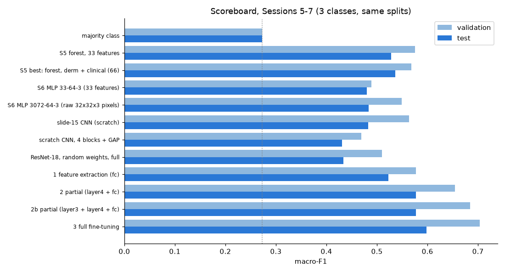

# Session 7 homework — the scoreboard, and what a pretrained CNN adds

**Computer Vision & Speech Recognition** · Joshua Cole · MILK10k skin-lesion classification (Benign / Indeterminate / Malignant) · seed 42 splits

**Repository:** <https://github.com/jcole-jpg/Computer-Vision-and-Speech-Recognition>

**Code that completes the homework (slide 30):**
[`notebooks/07_cnn.ipynb`](https://github.com/jcole-jpg/Computer-Vision-and-Speech-Recognition/blob/main/notebooks/07_cnn.ipynb) (the experiment, executed, every table and figure; PDF: [`notebooks/07_cnn.pdf`](https://github.com/jcole-jpg/Computer-Vision-and-Speech-Recognition/blob/main/notebooks/07_cnn.pdf)) ·
[`src/milk10k/cnn.py`](https://github.com/jcole-jpg/Computer-Vision-and-Speech-Recognition/blob/main/src/milk10k/cnn.py) (tensors, augmentation, networks, fine-tuning strategies, cached training runs) ·
[`scripts/build_session7_notebook.py`](https://github.com/jcole-jpg/Computer-Vision-and-Speech-Recognition/blob/main/scripts/build_session7_notebook.py) (generates and runs the notebook) ·
[`tests/test_cnn.py`](https://github.com/jcole-jpg/Computer-Vision-and-Speech-Recognition/blob/main/tests/test_cnn.py) (13 tests).
Raw outputs: [`artifacts/session07/scoreboard.csv`](https://github.com/jcole-jpg/Computer-Vision-and-Speech-Recognition/blob/main/artifacts/session07/scoreboard.csv), [`artifacts/session07/mini_challenge.csv`](https://github.com/jcole-jpg/Computer-Vision-and-Speech-Recognition/blob/main/artifacts/session07/mini_challenge.csv), [`artifacts/session07/scores.json`](https://github.com/jcole-jpg/Computer-Vision-and-Speech-Recognition/blob/main/artifacts/session07/scores.json), [`artifacts/session07/runs/`](https://github.com/jcole-jpg/Computer-Vision-and-Speech-Recognition/blob/main/artifacts/session07/runs).
Earlier scoreboard rows: [`notebooks/05_classical_baseline.ipynb`](https://github.com/jcole-jpg/Computer-Vision-and-Speech-Recognition/blob/main/notebooks/05_classical_baseline.ipynb), [`notebooks/06_neural_networks.ipynb`](https://github.com/jcole-jpg/Computer-Vision-and-Speech-Recognition/blob/main/notebooks/06_neural_networks.ipynb).

## Result

**The model to bring to Session 8 is ResNet-18 pretrained on ImageNet and fine-tuned in full (strategy 3, the optional homework): validation macro-F1 0.703, test macro-F1 0.598
(95 % bootstrap interval [0.530, 0.662]), test accuracy 0.754.** It was chosen by validation macro-F1 alone, the highest of everything in Sessions 5–7, and the test split was scored once, after every choice was fixed.
Always predicting the majority class scores 0.273.

## The scoreboard, Sessions 5–7 (same lesion-level splits; macro-F1)

| session | model | trainable params | validation | test | test accuracy | Malignant recall |
|---|---|---|---|---|---|---|
| 5 | majority class | 0 | 0.273 | 0.273 | 0.694 | – |
| 5 | Session 5 forest, 33 features | – | 0.575 | 0.528 | – | – |
| 5 | Session 5 best: forest, derm + clinical (66) | – | 0.568 | 0.536 | 0.744 | – |
| 6 | Session 6 MLP 33-64-3 (33 features) | 2,371 | 0.489 | 0.480 | 0.637 | – |
| 6 | Session 6 MLP 3072-64-3 (raw 32x32x3 pixels) | 196,867 | 0.549 | 0.484 | 0.724 | – |
| 7 | slide-15 CNN (scratch) | 306,147 | 0.564 | 0.483 | 0.717 | 0.779 |
| 7 | scratch CNN, 4 blocks + GAP | 389,667 | 0.469 | 0.431 | 0.600 | 0.621 |
| 7 | ResNet-18, random weights, full | 11,178,051 | 0.510 | 0.434 | 0.662 | 0.777 |
| 7 | 1 feature extraction (fc) | 1,539 | 0.577 | 0.523 | 0.700 | 0.742 |
| 7 | 2 partial (layer4 + fc) | 8,395,267 | 0.654 | 0.577 | 0.768 | 0.842 |
| 7 | 2b partial (layer3 + layer4 + fc) | 10,494,979 | 0.684 | 0.577 | 0.737 | 0.739 |
| 7 | 3 full fine-tuning  **[PICK]** | 11,178,051 | 0.703 | 0.598 | 0.754 | 0.788 |

## How to read it

* **Pretraining is what matters.** The same ResNet-18 from random weights scores 0.510 on validation and 0.434 on test; from ImageNet weights, fully fine-tuned, 0.703 and 0.598. Small networks trained from scratch on 3,742 lesions
  (slide-15 net 0.483, four-block net 0.431 on test) do no better than Session 6's MLPs (0.480, 0.484).
* **More unfrozen layers, better score, higher cost:** `fc` only 0.523 (8.7 s/epoch), `layer4 + fc` 0.577 (11.0 s), `layer3 + layer4 + fc` 0.577 (15.0 s), everything 0.598 (31.0 s) on test.
  The gaps between the last three are inside the seed noise measured in the mini-challenge (std 0.023 on validation), so `layer4 + fc` is statistically indistinguishable from the pick at a third of the training time.
* **Against Session 5's forest** (test 0.536, interval [0.472, 0.601]) the pick is +0.062; the intervals overlap, so this is a likely improvement on 749 test lesions, not a proven one.
* **Validation is optimistic** for every model (0.703 against 0.598 for the pick): the best epoch and the best model were both chosen on it. The test number is the one to quote.
* **What it gets wrong:** per-class recall on test is Benign 0.70, Indeterminate 0.41, Malignant 0.79; 96 of 520 malignant lesions are called benign. At argmax the cost per lesion (missed malignant 50, unnecessary work-up 1) is 6.65,
  well above the 0.40 of always answering "Malignant"; the matrix calls for a screening threshold below 0.5, which is not tuned here.

## EfficientNet or DenseNet versus ResNet

**DenseNet-121 differs from ResNet-18 in how it reuses earlier features: where a ResNet block adds its input to its output (`x + f(x)`), each DenseNet layer receives the concatenated feature maps of all earlier layers in its block,
so features are reused instead of relearned and the network gets by with 8.0 M parameters against 11.7 M, at the price of more memory per layer.**
EfficientNet-B0 keeps ResNet's skip connections but replaces its plain 3×3 blocks with MBConv blocks (depthwise-separable convolutions with squeeze-and-excitation) and sets depth, width and input resolution together by one scaling rule,
reaching 5.3 M parameters. Parameter counts are from torchvision (notebook section 7); neither network was trained here, so no accuracy claim is made for them.

## Protocol and assumptions

* Dermoscopic image of each lesion only, stretched to 224×224, ImageNet normalisation, flips / quarter turns / mild brightness and contrast on training batches only; class-weighted cross-entropy; Adam; **10 epochs** for every network; the best-validation epoch is kept.
* Pretrained layers train at 1e-4, the new head (and every from-scratch network) at 1e-3; frozen layers keep their BatchNorm statistics.
* Seed 0 for the scoreboard; seeds 1 and 2 only for the mini-challenge, so strategy 3's number comes from a single run. Apple MPS training is not bit-for-bit repeatable; the notebook caches every run, so re-executing it reproduces the numbers above.
* Sessions 5 and 6 rows are read from `artifacts/session05` and `artifacts/session06` (same splits), not retrained.
